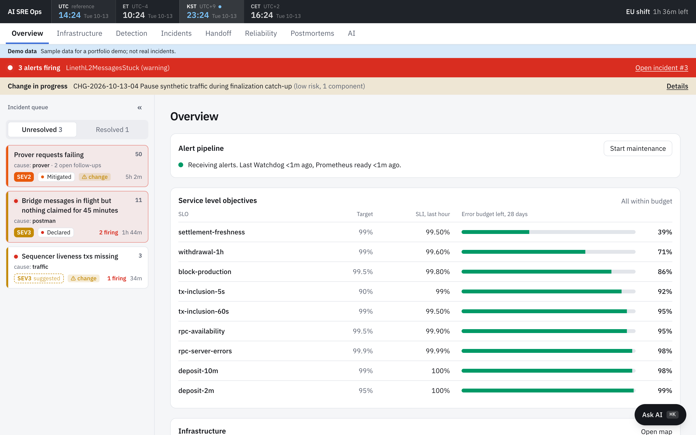
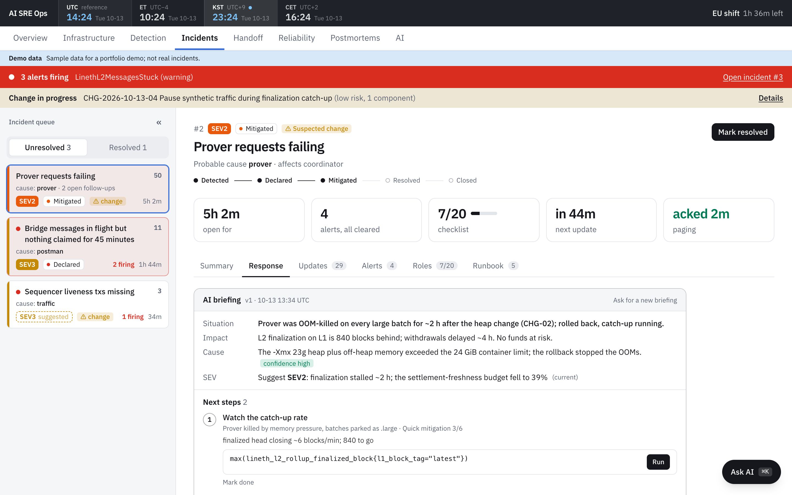
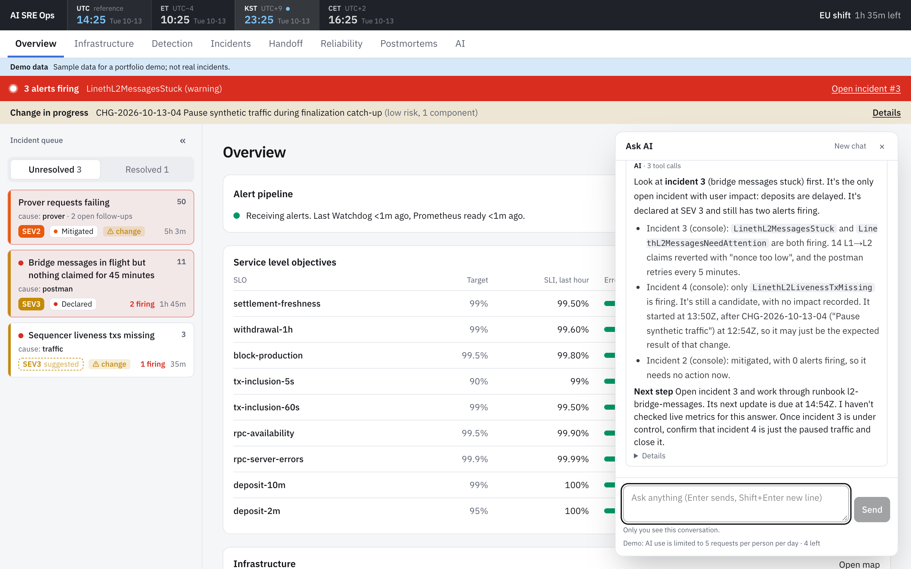
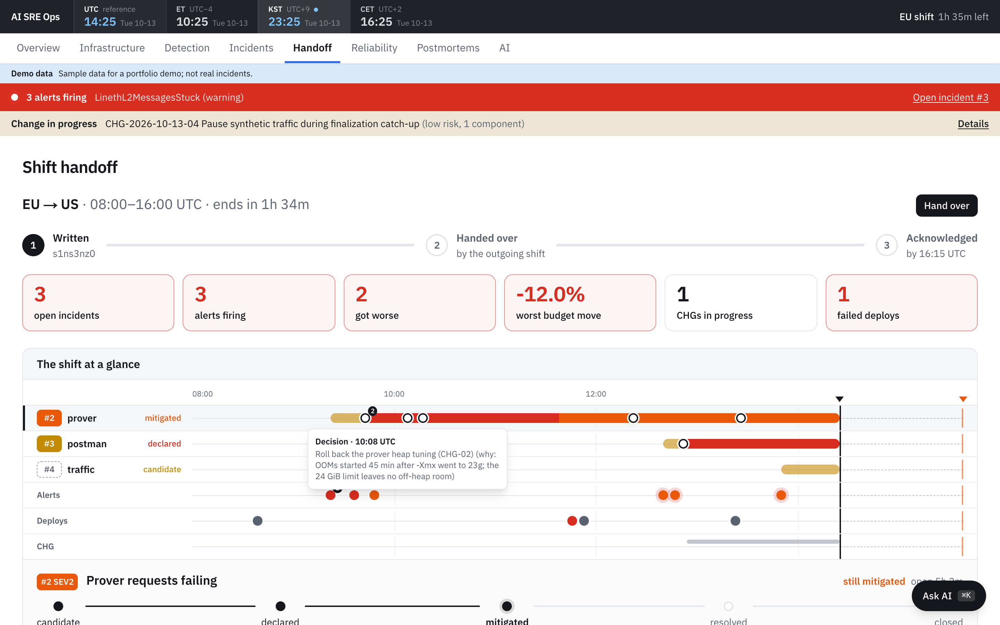
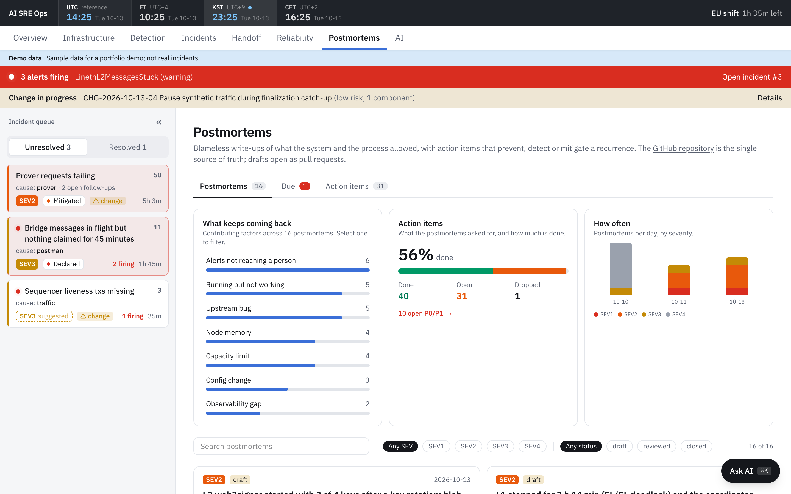
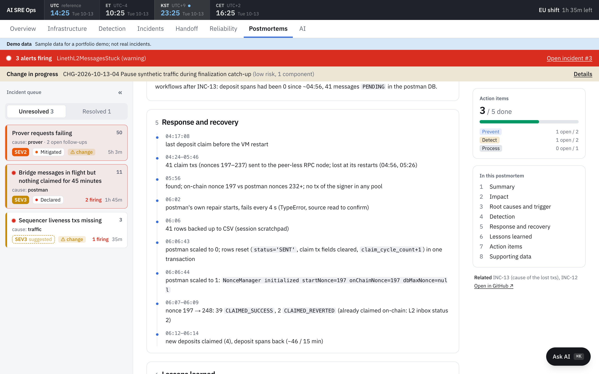
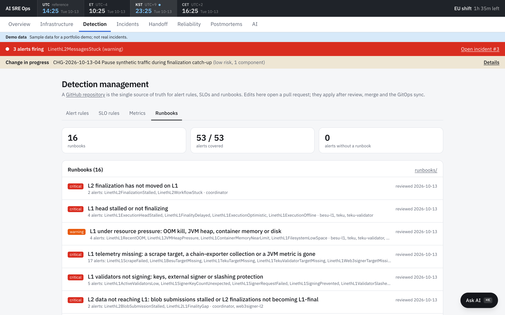

# AI SRE Ops

An incident console for an L2 rollup lab (Lineth L2): alerts become incidents, an AI agent briefs the incident
commander with the next runbook steps, shifts hand over with one picture, and postmortems close the loop.

**Live demo (sample data):** https://ops.miata.cloud/sre — the AI is limited to 5 requests per visitor per day.

## Overview



The first screen of a shift. The incident queue on the left is ordered by a priority score (SLO burn, impact,
age, trend); declared incidents stand out in red. Next to it: error budgets per SLO, the health of every
component, and banners for alerts firing and changes in progress.

## AI briefing



When an incident is declared, the AI reads the incident, its runbooks and live metrics, then posts a briefing:
situation, impact, likely cause with confidence, a SEV suggestion, and the next steps. Each step points at a
runbook step and carries its query (run it in place) or its command. Changes run only after the incident
commander clicks Approve & run; the AI can never change the cluster itself.

## Ask AI



A chat on every screen (⌘K). The AI answers from the console's data and the lab's metrics, in a fixed short form:
conclusion, evidence, next step.

## Shift handoff



The outgoing shift in one picture: each incident's states and turning points on a timeline (hover any dot for
what happened), alerts, deploys and changes. Below it, a card per open incident with its next step, firing
alerts linked to their runbooks, and a note for the next person. The incoming shift acknowledges after reading.

## Postmortems



Blameless postmortems in the Google SRE format, kept in Git and read by the console. The dashboard shows what
keeps coming back (contributing factors across postmortems), how much of the follow-up work is done, and how
often incidents happen by severity. Incidents that owe a postmortem are listed, and a draft can be opened as a pull
request from the incident.



Each postmortem reads like a report: key facts, a summary, the response as a timeline, lessons learned, and
action items with their progress.

## Detection



Alert rules, SLOs, runbooks and the metric inventory, with a Git repository as the single source of truth. Edits
open a pull request; CI checks that every alert has a runbook (53 of 53 today).

---

## Run locally

Needs Node 24+ (scripts run `.ts` directly) and Docker. `npm run dev` reads `.env.local` itself; the `set -a` line is for the scripts.

```sh
cp .env.example .env.local          # set WEBHOOK_TOKEN
docker compose up -d db
set -a; . ./.env.local; set +a
npm ci && npm run db:migrate
npm run dev                          # http://localhost:3000
npm run replay                       # INC-2026-10-11-11 (+ overlapping INC-10) into the webhook
```

Demo mode on sample data, with no cluster behind it: `npm run demo:seed`, then `npm run dev:demo`.
Alertmanager receiver: `webhook_configs: [{url: <app>/api/alertmanager, http_config: {authorization: {credentials: <WEBHOOK_TOKEN>}}}]`.

## Test (Linux container, same as CI)

The integration test creates and drops its own Postgres schema, so it never touches dev data.

```sh
docker compose --profile test run --rm test   # unit + Postgres integration + typecheck
```

## Security

Server actions trust `X-Forwarded-User` from oauth2-proxy and production refuses requests without it. Expose the app
only through the proxy (ClusterIP Service + NetworkPolicy); never publish it directly. The webhook needs `WEBHOOK_TOKEN`.
The AI only reads; a change is a card the incident commander approves, run by a separate executor the agents cannot reach.
